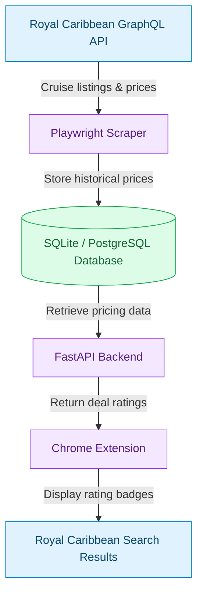

###Cruiseka — Cruise Price Tracker

A full-stack cruise price tracking tool that helps travelers evaluate Royal Caribbean cruise deals using historical pricing data.

Cruiseka automatically collects cruise prices, stores historical observations, and displays price ratings directly on Royal Caribbean's search results through a Chrome extension.

Tech Stack: Python · FastAPI · SQLAlchemy · Playwright · JavaScript · Chrome Extensions · SQLite / PostgreSQL

##System Architecture

Cruiseka uses a data pipeline to collect cruise prices, store historical observations, and deliver price ratings through a Chrome extension.


The scraper retrieves cruise listings from Royal Caribbean's GraphQL API. SQLAlchemy persists cruise information and daily price observations. FastAPI serves pricing evaluations to the Chrome extension, which displays ratings on matching cruise cards.

## What it does

- Loads Royal Caribbean's Europe results through the paginated GraphQL search
  used by `backend/scraper.py`.
- Extracts each sailing's itinerary, dates, and price from the API response.
- Stores one cruise row per sailing and one price-history observation per
  sailing and scrape day.
- Shows a rating badge on Royal Caribbean result cards after at least five daily
  observations exist for that exact sailing.

## Setup

These commands are for macOS and Linux.

```bash
# Create and activate the virtual environment
python3 -m venv .venv
source .venv/bin/activate

# Install Python dependencies
python -m pip install -r requirements.txt

# Create the database tables
python -m backend.init_db

# Start the API used by the extension
python -m uvicorn backend.main:app --reload

# In another terminal, run the Europe scraper
python -m backend.scraper
```

The scraper uses Playwright's request API for the GraphQL endpoint; it does not
launch a browser. By default, the API and scraper share a local SQLite database
at `data/cruises.db`, and scraper CSV output goes to
`data/royal_caribbean_cruises.csv`.
No database configuration is required for this local setup.

To use PostgreSQL instead, create `.env` and set `DATABASE_URL`:

```bash
cp .env.example .env
```

Then replace its SQLite URL with the PostgreSQL example shown in that file. Both
the API and scraper read the same setting from `backend/database.py`.

## Command notes

- Creating and activating `.venv` is normally required only once per local setup. Activate it again when starting a new terminal session.
- `backend/init_db.py` creates missing database tables. It does not migrate existing tables when a model's column type changes.
- `python -m uvicorn backend.main:app --reload` starts the FastAPI development server.
- `python -m backend.scraper` loads all current Europe listings, appends a CSV snapshot,
  and inserts or updates the shared database.
- Local `.env` and SQLite database files are ignored by Git.

## Load the Chrome extension

1. Start the API at `http://127.0.0.1:8000`.
2. Open `chrome://extensions`, enable **Developer mode**, and choose
   **Load unpacked**.
3. Select only this project's `extension/` folder.
4. Visit Royal Caribbean's Europe-filtered cruise results.

The local API returns a waiting message until a sailing has five distinct scrape
days. After that, the badge shows an emoji, signed percentage from average, and
the seven-band price rating.

Daily scheduling is deployment-specific. During local development, run the
scraper once per day with cron, launchd, or another scheduler.

## Future scheduled-job failure alerts

Daily scheduling and email delivery are not implemented yet. The reusable
integration point is `run_scraper_job()` in `backend/scrape_job.py`. A future scheduler
should call that function instead of calling `run_scraper()` directly and pass
it one email notification callback:

```python
from backend.scrape_job import run_scraper_job
from future_email_provider import send_scrape_failure_email

run_scraper_job(notify_failure=send_scrape_failure_email)
```

On success, the callback is not called. On an exception or an invalid result
(zero listings or zero rows), it is called once with the local date/time, stage,
error type, and error message; the original error is then re-raised so the
scheduler also records a failed run. Configure the future email implementation
through the `SCRAPER_ALERT_EMAIL_*` and `SMTP_*` variables documented in
`.env.example`. Do not put credentials in source control.

## Run the tests

Install the development dependencies and run pytest:

```bash
python -m pip install -r requirements-dev.txt
python -m pytest -v
```

The tests force application imports to use an in-memory database and create a
separate temporary SQLite database per test, so they never read or write the
local `data/cruises.db` file.
